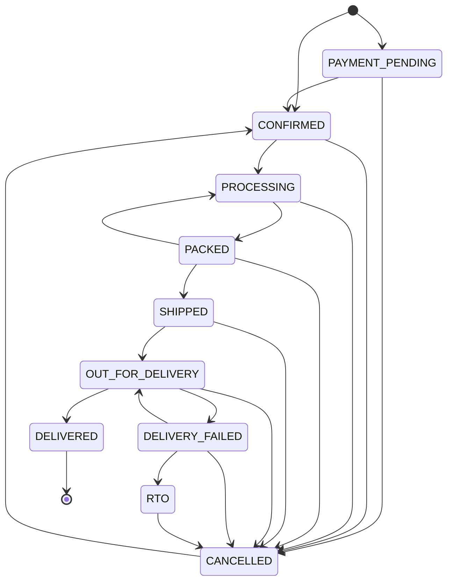

# Order states and how money is put right

This page lists every state an order, a preorder and a gift order can be in,
the moves between them, and every path that puts money right when something
goes wrong. The code is the source: `ORDER_TRANSITIONS` in
`mango-api/src/orders.js`, and `mango-api/src/payments.js`.

**The refund rule.** MandiMangoes refunds in two cases only:

1. a customer cancels their own paid order (or booking) before it is packed;
2. a manager cancels a paid order or booking that we cannot deliver.

Any other problem (bruised fruit, a late box, a wrong item) is settled with a
free replacement order, never with money. A refund is always the **full**
amount paid for that order or booking. **Partial refunds are not offered**, by
business rule: there is no way to refund part of an order, on the panel or in
the API. (A gift order sent to several people is the one case where a payment
is refunded in parts: each cancelled delivery gets back its own full price.)

Money we never asked for goes back too: a second payment for something already
paid, and a payment for the wrong amount. Those refunds are automatic.

## Orders

<!-- order-states:start (generated by mango-api/scripts/order-states.mjs; do not edit by hand) -->

| Status | Meaning |
|---|---|
| `PAYMENT_PENDING` | Placed; stock is held for the hold time while the customer pays. |
| `CONFIRMED` | Paid (or a free replacement). Stock is set aside for its day. |
| `PROCESSING` | Being picked or packed. |
| `PACKED` | Packed; waiting for dispatch. |
| `SHIPPED` | Left the warehouse. |
| `OUT_FOR_DELIVERY` | With the rider on its day; the customer has a delivery code. |
| `DELIVERY_FAILED` | The rider could not deliver; retried on the next day with room, up to 3 times. |
| `RTO` | Returned to us ("Returned" on the panel). |
| `CANCELLED` | Cancelled. A paid one is refunded in full. |
| `DELIVERED` | Delivered, with the code, a photo, or a manager saying why not. Final. |

| From | To | How |
|---|---|---|
| `PAYMENT_PENDING` | `CONFIRMED` | The payment is captured (webhook, Checkout reply, or the reconcile loop). |
| `PAYMENT_PENDING` | `CANCELLED` | The hold runs out unpaid, the payment cannot be started, or the customer or staff cancel. |
| `CONFIRMED` | `PROCESSING` | Staff start it, or the warehouse picks its first labelled box. |
| `CONFIRMED` | `CANCELLED` | The customer cancels (refund if paid), or a manager cancels with a full refund. |
| `PROCESSING` | `PACKED` | Staff mark it packed, or the warehouse finishes the pack session. |
| `PROCESSING` | `CANCELLED` | The customer cancels (refund if paid), or a manager cancels with a full refund. |
| `PACKED` | `SHIPPED` | Staff dispatch it, or the warehouse finishes the dispatch session. |
| `PACKED` | `CANCELLED` | A manager cancels with a full refund (the customer can no longer cancel). |
| `PACKED` | `PROCESSING` | The warehouse takes a box off it (unpick); it is packed again. Staff cannot make this move by hand. |
| `SHIPPED` | `OUT_FOR_DELIVERY` | Staff send it out with the rider on its delivery day (a manager can send one early, saying why). |
| `SHIPPED` | `CANCELLED` | A manager cancels with a full refund. |
| `OUT_FOR_DELIVERY` | `DELIVERED` | The customer's code or a photo, or a manager's override with a reason. |
| `OUT_FOR_DELIVERY` | `DELIVERY_FAILED` | The rider records a missed delivery. |
| `OUT_FOR_DELIVERY` | `CANCELLED` | A manager cancels with a full refund. |
| `DELIVERY_FAILED` | `OUT_FOR_DELIVERY` | The retry goes out. |
| `DELIVERY_FAILED` | `RTO` | The boxes come back to us. |
| `DELIVERY_FAILED` | `CANCELLED` | A manager cancels with a full refund. |
| `RTO` | `CANCELLED` | A manager cancels with a full refund. |
| `CANCELLED` | `CONFIRMED` | A late payment: it lands after the hold ran out. Only for an order cancelled by the hold, never one the customer or staff cancelled (that payment is refunded). |



<!-- order-states:end -->

To change a move: change `ORDER_TRANSITIONS`, add a migration that changes the
`order_status_transitions` table, and run `node scripts/order-states.mjs` in
`mango-api/` to rewrite the table and diagram above. `test/order-guards.test.js`
fails until all three agree.

**The database guards it too** (migration 045). A trigger on `orders` refuses
any status change that is not in `order_status_transitions` (error
`check_violation`, constraint `orders_status_transition`), and a new order must
start as `PAYMENT_PENDING` (checkout, chat, gifts, subscriptions) or `CONFIRMED`
(a preorder turned into an order, a free replacement). The app checks every
move first (`assertTransition`), so the trigger only fires on a bug or a hand
edit. A repair by hand lifts it for one transaction only:

```sql
BEGIN;
SET LOCAL mango.order_status_override = 'on';
UPDATE orders SET status = '...' WHERE id = '...';
COMMIT;
```

Write an `order_events` row for the change as well, so the history explains it.

### Payment status (`orders.payment_status`)

| Value | Meaning |
|---|---|
| empty | No payment expected: a free replacement. |
| `INITIATED` | Checkout started; waiting for the payment. |
| `SUCCEEDED` | Paid. Also what a refund that failed at Razorpay goes back to. |
| `FAILED` | The payment could not be started; the order was cancelled. |
| `CANCELLED` | Cancelled before it was paid. |
| `REFUNDED` | A refund was sent and Razorpay accepted it (see `refund_status`). |

One failed attempt at Razorpay (a card declined) changes nothing: the customer
can try again on the same payment page until the hold ends.

### Refund status (`refund_status`, on orders, preorders and second payments)

| Value | Meaning |
|---|---|
| empty | No refund sent yet. With `refund_requested_at` set, one is due. |
| `pending` | Sent; Razorpay accepted it and has not yet said it is done. |
| `processed` | Razorpay says the money went back. |
| `failed` | Razorpay refused it. Sent again after a back-off. With `refund_gave_up_at` set, it has used up its attempts: a manager settles it. |
| `manual` | A manager paid the customer back another way and recorded the reference. |

The other refund columns: `refund_requested_at` (when it became due),
`refund_attempts`, `refund_next_attempt_at` (no attempt before this),
`refund_gave_up_at`, `refunded_at` and `refund_id` (Razorpay's id, or
`manual:<reference>`).

## Preorders (bookings for a later week)

| Status | Meaning |
|---|---|
| `PAYMENT_PENDING` | Capacity in the week is held while the customer pays. |
| `WAITLISTED` | The week was full; waiting for a spot. |
| `BOOKED` | Paid; the week's capacity is taken. |
| `CONVERTED` | Its order exists. From here on the order's states apply (a cancel goes through the order). |
| `CANCELLED` | Cancelled. A paid one is refunded in full. |

Moves: `PAYMENT_PENDING` to `BOOKED` (paid) or `CANCELLED` (the hold ran out, or a
cancel); `WAITLISTED` to `PAYMENT_PENDING` (a spot opened; the customer gets a
payment link) or `CANCELLED`; `BOOKED` to `CONVERTED` (its week came) or
`CANCELLED` (the customer, or a manager, with a full refund); `CANCELLED` to
`BOOKED` for a payment that lands after the hold ran out. These moves are spread
over `mango-api/src/preorders.js` rather than kept in one map, so the database
does not guard them the way it guards orders.

## Gift orders (one payment, several deliveries)

| Status | Meaning |
|---|---|
| `PAYMENT_PENDING` | Waiting for the one payment. A hold that ran out cancels the deliveries but leaves this status, so a late payment is still honoured. |
| `PAID` | Paid. Each delivery is an ordinary order from here on. |
| `CANCELLED` | The buyer cancelled before paying, the payment could not be started, or every delivery was cancelled. |

Each delivery is an order with the states above. The buyer can cancel the whole
gift order until any delivery is packed, or one paid delivery at a time; each
cancelled delivery is refunded its own full price.

## When something goes wrong: every compensation path

| What happened | What the system does | Who acts |
|---|---|---|
| **The hold runs out unpaid** | The order is cancelled ("Payment not received before the hold expired") and its stock goes back on sale. Bookings give their week's capacity back. | Nobody: the maintenance run (every minute). |
| **The payment lands after the hold ran out** | The order is confirmed after all (`CANCELLED` to `CONFIRMED`), never refunded: on its own date if there is still stock and room, else on the next date with stock, else flagged at risk for staff. Bookings and gift orders work the same way. | Nobody; at-risk orders show on Needs attention. |
| **Paid after the customer or staff cancelled** | The order stays cancelled and the payment is refunded in full. | Nobody. |
| **Charged twice** (two tabs, a retried link) | The second payment is recorded in `duplicate_payments` and refunded; the order is untouched. | Nobody. |
| **A payment for the wrong amount or currency**, or with no payment id | It confirms nothing. It is listed under Webhook problems and, when it has an id, refunded like a second payment. | Nobody; staff see it listed. |
| **A refund fails** (Razorpay errors, or later says `refund.failed`) | It is sent again with a new receipt, after 2, 4, 8, 16, 32 and then 60 minutes. Before each attempt Razorpay is asked for refunds already made, so a retry never pays twice. | Nobody, for up to 8 attempts. |
| **A refund fails 8 times** | It stops: `refund_status` `failed`, `refund_gave_up_at` set, a line in the order's history, and Needs attention shows **Refund failed: needs a manager**. It is never sent again on its own. | A manager: check the payment in the Razorpay dashboard, pay the customer back another way, and press **Paid back another way** with the reference. If Razorpay turns out to hold a refund after all, the panel says so and the next run records it instead. |
| **Razorpay can never refund** (account closed, bank refuses) | As above: **Paid back another way** records it as refunded (`manual`), so it is not sent again and Analytics counts it. | A manager. |
| **A chargeback (dispute)** | Recorded from `payment.dispute.*` and listed under Payment disputes until won, lost or closed. With `REFUND_SAFETY_CHECKS`, a refund due on that payment waits while the dispute is open (a refund on top of a chargeback pays twice); if we win it goes out, if we lose the bank has already paid the customer and a manager records it as paid back, with the dispute id as the reference. | A manager answers the dispute in the Razorpay dashboard. |
| **A webhook is lost** | Orders waiting for payment are checked at Razorpay (after 2 minutes, for a day; ones the sweep cancelled, for a day, every 15 minutes); bookings for 3 days. With `PAYMENT_DAILY_RECON`, once a day every payment Razorpay captured in the last 3 days is matched to an order or booking, or listed once on Needs attention for a manager to refund. | Nobody; unmatched money shows on Needs attention. |
| **A webhook fails while it is processed**, or the server dies mid-way | Every signed webhook is stored as received (`webhook_events`) before any work. The work marks it done in its own transaction. One still not done after 5 minutes is replayed by the maintenance run, up to 5 times, 5 minutes apart; then it is listed under Webhook problems as needing a manager. Razorpay's own retries still arrive; a replay and a retry can't apply the same event twice (`processed_webhooks`, and WhatsApp messages by their id). Stored bodies are deleted after 30 days (WhatsApp after 7). | Nobody, unless it is listed. |
| **The same webhook arrives twice** (or a replay of one already done) | Nothing happens the second time. | Nobody. |
| **A delivery fails** | Retried on the next day with room, up to 3 times; then Needs attention asks staff to call the customer. A manager may cancel with a full refund if we cannot deliver. | Staff. |
| **Fruit arrives damaged, late or wrong** | The customer raises a claim; staff settle it with a free replacement order. No refund. | Staff. |

### The daily payment check (`PAYMENT_DAILY_RECON`)

Once a day the maintenance run asks Razorpay for every payment captured in the
last 3 days. A payment we have no record of is applied as its webhook would have
been (paid, late payment, second payment, or a refund after a cancel) when it
names one of our Razorpay orders or payment links; any other is listed once on
Needs attention, where a manager can refund it. It is the backstop for a lost
webhook on a payment the shorter checks no longer look at (a late payment, or a
link nobody is polling).

**Turn it on in production.** Unset, it is on in production and off elsewhere
(`mango-api/src/env.js`); `PAYMENT_DAILY_RECON=false` turns it off. Without
Razorpay keys it does nothing in production.

### Signatures are checked on the raw body

The Razorpay and WhatsApp webhooks are verified over the exact bytes received,
before the body is parsed. The same JSON re-formatted (spaces, key order) no
longer matches its signature and is refused (`test/webhook-intake.test.js`).

## What to watch

- `mango_payments_failed_total`: failed payment attempts reported by Razorpay.
- `mango_refund_failures_total{kind}`: refund attempts that failed, by table.
- `mango_webhook_lag_seconds{provider}`: from when Razorpay says the event
  happened to when it arrived. The `razorpay webhook` log line carries the same
  number as `lagSeconds`.
- Needs attention: Refunds not sent, Webhook problems, Payment disputes.
